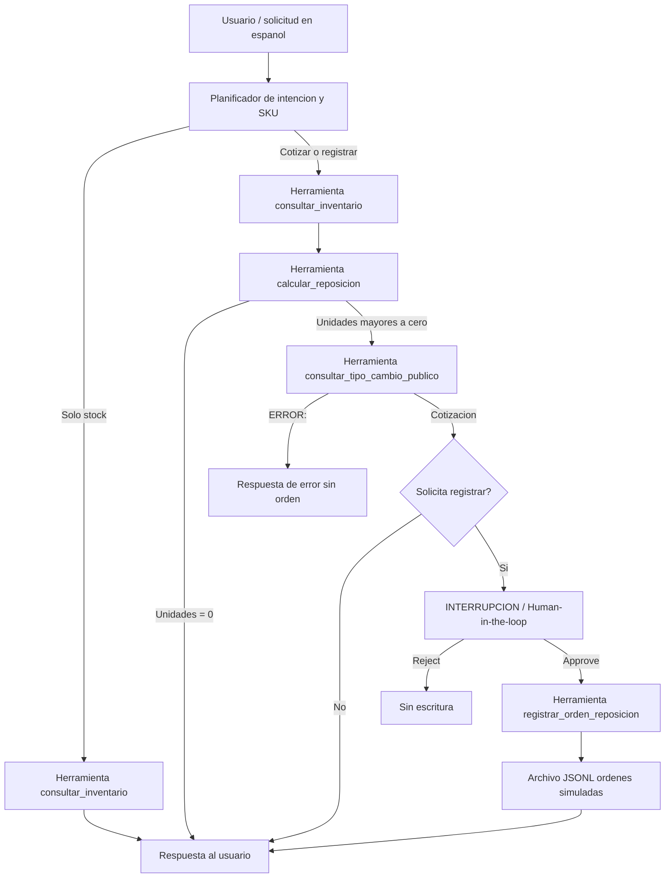
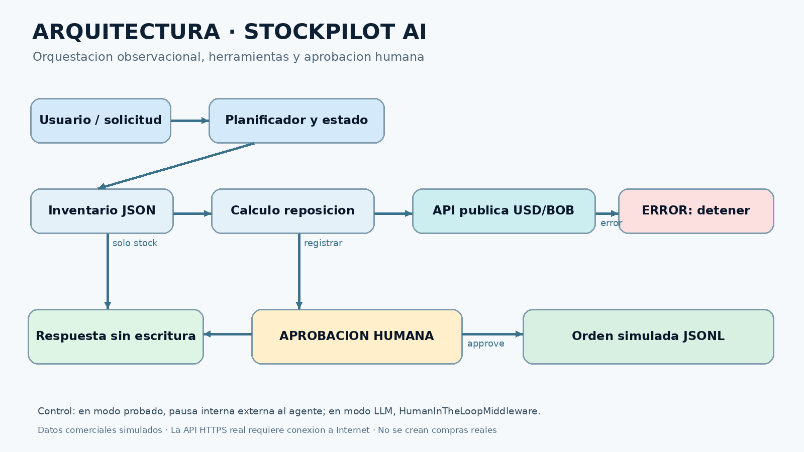

# StockPilot AI | Agente inteligente de reposicion y control de compras

**Trabajo final de diseno y orquestacion de agentes inteligentes y manejo de herramientas.**  
**Caso propio:** comercio de accesorios tecnologicos ALKOSTO PLUS (escenario academico; todas las cifras de negocio son SIMULADAS).  
**Version:** 1.0 - 15 de noviembre de 2026.  
**Modo probado:** motor agentico por reglas, independiente de claves de IA.  
**Modo adicional:** adaptador opcional con ChatOpenAI + `HumanInTheLoopMiddleware` de LangChain.

> Aviso de veracidad: **La evaluacion 5/5 y las 10 pruebas unitarias se ejecutaron** sobre el orquestador por reglas con tipo de cambio simulado. No se ejecuto una consulta HTTPS desde la maquina de pruebas porque la red saliente no resolvio nombres de dominio. El codigo de la herramienta de API real esta completo, pero para comprobar su ejecucion en vivo debe correrse `python main.py --live-api` desde una computadora con Internet. **Tampoco se ejecuto el adaptador LangChain** en este entorno por falta de esas dependencias y de una clave personal.

## 1. Problema, usuario y solucion

**Problema de trabajo:** en una tienda de dispositivos y accesorios, el encargado necesita revisar stock, interpretar el consumo reciente, calcular la cantidad de reposicion y estimar el costo de adquisicion antes de registrar un pedido. Sin un control de autorizacion, una orden prematura puede crear un compromiso administrativo equivocado. La consulta manual a una fuente cambiaria externa introduce latencia y posibles errores de servicio.

**Usuario:** responsable de inventario y supervisor de compras de ALKOSTO PLUS.

**Solucion propuesta:** StockPilot responde peticiones en espanol, elige herramientas, observa sus resultados, ejecuta calculos, detiene el flujo en caso de fallo externo y solicita consentimiento humano ANTES de registrar una orden. En esta entrega, registrar significa **anadir una linea irreversible a un archivo de ordenes simuladas**, no contactar ni comprar a proveedores.

**Por que agente y no un workflow fijo?** La ruta no siempre es la misma: una consulta de existencias usa una sola herramienta; una cotizacion usa tres; el stock suficiente evita API y orden; un fallo externo aborta; un registro propuesto se suspende hasta obtener una decision externa. El orquestador selecciona y encadena acciones segun la solicitud y sus observaciones. Es un **agente simbolico dirigido por reglas**, no un modelo generativo en el modo probado. Se incorpora un adaptador LLM opcional para quien desee evaluar planeacion generativa.

## 2. Arquitectura del agente





### Los cinco primitivos del agente

| Primitivo | Implementacion comprobable |
|---|---|
| **1. Instrucciones** | `StockPilotAgent.run()` y `system_prompt` en `stockpilot/langchain_agent.py`: consultar antes de registrar, no inventar tipo de cambio, detenerse ante `ERROR:` y no autoconcederse permisos. |
| **2. Herramientas** | `consultar_inventario` (JSON local), `calcular_reposicion` (formula), `consultar_tipo_cambio_publico` (GET HTTPS a API real) y `registrar_orden_reposicion` (archivo JSONL). |
| **3. Memoria** | Catalogo local `data/inventario_simulado.json`; estados pendientes por `thread_id` en `agent.pending`; archivo JSONL de ordenes; en modo LLM se usa `InMemorySaver` de LangGraph. Memoria de demo en RAM, no persistente entre procesos. |
| **4. Estado** | `sin_herramientas`, `finalizado`, `error_api`, `PENDIENTE_APROBACION_HUMANA`, `RECHAZADO_POR_HUMANO`, `APROBADO_Y_REGISTRADO_SIMULADO`, con trazas en JSON. |
| **5. Control** | Interrupcion ANTES de la herramienta de escritura. `resume(thread_id, "approve" | "reject")` exige decision externa. En modo LangChain, la integracion usa la clase **real** `HumanInTheLoopMiddleware`, `interrupt_on` y `Command(resume=...)`. |

## 3. Herramientas y API publica REAL

**Herramienta 1 - `consultar_inventario(sku)`:** lee productos y ventas simuladas, devuelve stock y ventas de 14 dias.

**Herramienta 2 - `calcular_reposicion(sku)`:** recomienda 21 dias de cobertura:

```
stock_objetivo = ceil(ventas_14d / 14 * 21)
unidades_sugeridas = max(0, stock_objetivo - stock_actual)
costo_USD = unidades_sugeridas * costo_unitario_USD
costo_BOB = costo_USD * USD_BOB
```

**Herramienta 3 - `consultar_tipo_cambio_publico()`:** ejecuta la peticion **real** `GET https://open.er-api.com/v6/latest/USD` desde `stockpilot/tools.py`, con tiempo maximo de 5 s, validacion del JSON y del campo `rates.BOB`, excepciones de red, timeouts y respuestas HTTP. Ante cualquier error devuelve una cadena cuyo prefijo es `ERROR:`; el agente no crea orden ni inventa un valor. Sin credenciales.

La API es [ExchangeRate-API Open Access](https://www.exchangerate-api.com/docs/free): documenta acceso sin clave, atribucion obligatoria, actualizacion diaria y limites de uso. **Rates By [Exchange Rate API](https://www.exchangerate-api.com)**. Su resultado representa un dato referencial del proveedor, no una tasa oficial boliviana, una tasa bancaria negociada ni el tipo de cambio al que deba fijarse un precio de venta.

**Herramienta 4 - `registrar_orden_reposicion(...)`:** crea una orden SIMULADA en un JSONL, solo despues de confirmacion externa; incorpora `thread_id` para evitar que la repeticion de una misma autorizacion duplique la orden. No realiza una transaccion comercial.

**Modo sin Internet:** `SimulatedCurrency` devuelve `11.70` BOB/USD exclusivamente para hacer la demostracion repetible. No se presenta como tasa real. `FailingCurrency` inyecta un fallo HTTP 503 simulado para probar el manejo de errores. En pruebas unitarias tambien se verificaron los errores por timeout y la interpretacion de una respuesta HTTP emulada.

## 4. Control de aprobacion humana FUNCIONANDO

La accion de escritura (`registrar_orden_reposicion`) esta separada del calculo. Secuencia verificada:

1. El usuario solicita registrar una orden; el agente consulta stock, calcula y cotiza.
2. El agente devuelve `PENDIENTE_APROBACION_HUMANA` y **NO escribe nada**.
3. Un operador distinto al agente emite `approve` o `reject`.
4. `approve` habilita **un solo registro simulado**; `reject` finaliza sin ejecutar escritura.
5. Una decision invalida mantiene la pausa. El texto inicial "aprueba" dentro de la peticion no equivale a aprobacion externa.

**Forma humana de comprobarlo:** `python main.py --interactive`, escribir `Registra orden de cargador 20W` y responder `approve` o `reject` cuando la consola lo solicite.

**Modo LangChain LLM (no probado en este entorno):** en `stockpilot/langchain_agent.py` consta una implementacion literal de `HumanInTheLoopMiddleware(interrupt_on={"registrar_orden_reposicion": {"allowed_decisions": ["approve", "reject"]}})`, `InMemorySaver()` y `Command(resume={"decisions": [{"type": decision}]})`. Referencia: [documentacion oficial de LangChain](https://docs.langchain.com/oss/python/langchain/human-in-the-loop).

## 5. Evaluacion de 5 casos EJECUTADA

Ejecutar `python main.py --eval` produce `salidas/evaluacion_ejecutada.json`, `salidas/informe_evaluacion.md` y los archivos `salidas/caso_1.txt` a `caso_5.txt`. Cada caso se envia al **mismo orquestador** del CLI; se comparan **herramientas observadas**, herramientas prohibidas, estado, error y cambio en archivo antes/despues del control. No se escribieron salidas a mano.

| # | Solicitud / escenario | DEBE_USAR | NO_DEBE_USAR | Resultado observado |
|---|---|---|---|---|
| 1 | Consultar unidades de C20W | inventario | calculo, API, registro | **PASS** |
| 2 | Cotizar reposicion de CBLC | inventario, calculo, API | registro | **PASS** |
| 3 | Registrar C20W; operador aprueba | inventario, calculo, API, registro | ninguno | **PASS**: pausa primero, registra luego |
| 4 | Registrar CBLC; operador rechaza | inventario, calculo, API | registro | **PASS**: no hay escritura |
| 5 | Cotizar C40W; error HTTP simulado | inventario, calculo, API | registro | **PASS**: inicia con `ERROR:` |

**Porcentaje calculado:** `5 casos PASS / 5 casos ejecutados x 100 = 100%` de los criterios de caso. **No es porcentaje de la rubrica ni calificacion garantizada**. Evaluacion con motor por reglas y escenario de tipo de cambio simulado.

**Pruebas adicionales:** `python -m unittest discover -s tests -v` ejecuta 10 pruebas unitarias: decision de herramientas, cotizacion, HITL approve/reject, API fallida, limite por stock, timeout, parsing de respuesta HTTP emulada, decision invalida y solicitud desconocida.

## 6. Instrucciones de instalacion y ejecucion

Requisitos: Python 3.10+; Internet solo para llamadas API o dependencias nuevas.

```bash
# 1. Descargar / extraer el ZIP y entrar a la carpeta
cd ALKOSTO_StockPilot_Agente

# 2. Preparar entorno recomendado
python -m venv .venv
# Windows: .venv\Scripts\activate
# Mac/Linux: source .venv/bin/activate
pip install -r requirements.txt

# 3. Demostracion inmediatamente reproducible (datos simulados)
python main.py --demo

# 4. Evaluacion real sobre el orquestador (5 casos)
python main.py --eval

# 5. Test automatizados (10 casos)
python -m unittest discover -s tests -v

# 6. Operador interactivo (simulado)
python main.py --interactive

# 7. API externa REAL (requiere conexion a Internet)
python main.py --live-api
```

En `--live-api` escriba `Cotiza reposicion de cargador 20W`; observe en la traza `modo: API_REAL` si la peticion tiene exito, o `ERROR:` si hay problemas. **Sin conectividad no afirmar que la API fue llamada con exito.**

Para activar el modelo generativo **solo si desea ampliar el trabajo**:

```bash
pip install -r requirements-langchain.txt
# En la terminal de Windows PowerShell:
# $env:OPENAI_API_KEY="tu_clave_privada"
# En Linux/Mac:
# export OPENAI_API_KEY="tu_clave_privada"
python main.py --llm
```

El valor privado nunca se guarda en Git ni en entregables. El modo LLM puede generar cargos del proveedor del modelo y requiere verificar compatibilidad de las versiones al instalar.

## 7. Video demostrativo (3 a 5 minutos)

**Archivo entregado:** `evidencias/video_demostracion_stockpilot.mp4` (video SIN AUDIO de aproximadamente 4 min 36 s con capturas/representaciones de las salidas REALMENTE ejecutadas; no representa una grabacion en vivo de escritorio). El video muestra caso normal, fallo simulado `ERROR:`, aprobacion antes de la escritura, rechazo y porcentaje de evaluacion. Guion y minutaje: `evidencias/guion_del_video.md`.

Para cumplir el requisito de enlace externo de la evaluacion, **subir este MP4 a Google Drive, YouTube (No listado) o Loom y compartir el URL** en el texto final. El archivo local por si solo no es un enlace publico.

## 8. Publicacion en GitHub y texto de entrega

1. Crear en GitHub un repositorio privado o publico con nombre `StockPilot-Agente-Reposicion-ALKOSTO`.
2. Subir TODOS los archivos de esta carpeta, incluidos `salidas/`, `evidencias/`, `evaluacion/`, `tests/` y el `README.md`. GitHub no debe recibir `.env`, API keys ni archivos excluidos por `.gitignore`.
3. Verificar en GitHub que `salidas/caso_1.txt` a `caso_5.txt` y `salidas/evaluacion_ejecutada.json` sean legibles.
4. Subir el video y colocar su enlace en el README y en la respuesta del aula virtual.
5. Copiar `ENTREGA_EN_LINEA.txt` como texto de presentacion y reemplazar las partes marcadas **PENDIENTE** con enlaces autenticos (no inventarlos).

## 9. Limitaciones, consideraciones y fuentes

- Datos de inventario, ventas, costos y conversion offline totalmente **simulados** y no atribuibles a la actividad contable de ALKOSTO PLUS.
- Las ordenes escritas son educativas. En un sistema productivo se requieren autenticacion, transacciones, autorizaciones persistentes y auditoria centralizada.
- `InMemorySaver` es memoria de demostracion, no recupera hilos al reiniciar el proceso.
- API real configurada y documentada; su llamada directa **no pudo ejecutarse en el entorno de construccion por falta de DNS**. Si el docente exige evidencia de llamada HTTP real, ejecutarla en un equipo conectado y adjuntar captura/caso nuevo antes de presentar.
- Adaptador OpenAI + LangChain disponible como codigo; su ejecucion requiere instalacion de dependencias y clave del usuario y **no forma parte de los 5/5 verificados**.
- API del proveedor: https://www.exchangerate-api.com/docs/free y https://open.er-api.com/v6/latest/USD
- Control middleware de LangChain: https://docs.langchain.com/oss/python/langchain/human-in-the-loop

---

**Resumen para la rubrica de 100 puntos:** codigo reproducible con salidas visibles; README con cinco primitivos y diagrama; cuatro herramientas incluida API publica real mas tratamiento de errores; aprobacion externa ejecutada en modo reproducible y adaptador `HumanInTheLoopMiddleware`; 5 casos auditados; video 3-5 min. **El evaluador debe verificar la ejecucion de la API y del adaptador LangChain en su propio equipo; este repositorio no afirma haberlos ejecutado en esta sesion.**
